# EchoVote walkthrough: screen by screen

This guide follows the app screen by screen. For each screenshot it explains what you are looking at and the logic
behind it. For the full technical detail (image reading, model logic, heatmap algorithm) see
[HOW_IT_WORKS.md](../HOW_IT_WORKS.md).

> **Research tool, not a medical device.** The numbers in the screenshots are outputs of an academic prototype and are
> not diagnoses. A clinician must confirm every finding.

**Contents**
1. [Landing page](#1-landing-page)
2. [Analyze: choosing an input](#2-analyze-choosing-an-input)
3. [Result for a single pasted beat](#3-result-for-a-single-pasted-beat)
4. [Result for a photographed strip](#4-result-for-a-photographed-strip)
5. [Model Comparison tab](#5-model-comparison-tab)
6. [Ensemble Scores tab](#6-ensemble-scores-tab)
7. [All Models tab](#7-all-models-tab)
8. [A strip with an irregular rhythm](#8-a-strip-with-an-irregular-rhythm)
9. [History](#9-history)
10. [Guide and About](#10-guide-and-about)
11. [Reading the results correctly: known limitations](#11-reading-the-results-correctly-known-limitations)

---

## 1. Landing page

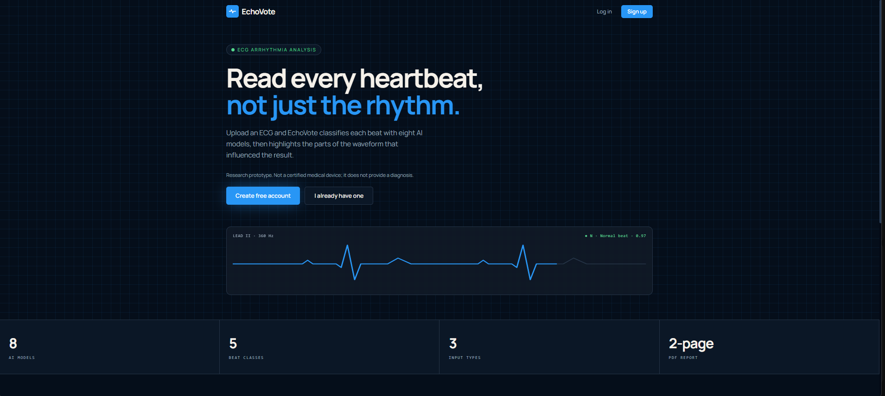

The public front page, with **Log in** and **Sign up**. Accounts are real: registration, login and password reset go
to the backend (`/auth/*`, `backend/auth.py`) and are stored in a SQLite database that persists in a Docker volume.
After logging in the user lands on the Analyze page.

Under the headline a short line states that this is a research prototype, not a certified medical device, and that it
does not provide a diagnosis. The animated ECG strip (with its "N · Normal beat · 0.97" label) is a decorative
illustration, not a live result. The four figures at the bottom (8 AI models, 5 beat classes, 3 input types, a 2-page
PDF report) describe features of the app; they are static text in `frontend/src/LandingPage.js`, not live measurements.

An earlier version of this page advertised "&lt;2s per recording" and "98%+ test accuracy". Both were removed: a single beat
takes a few seconds, a photographed strip takes 1 to 2 minutes, and the 98% was a beat-level figure on MIT-BIH data (test
and training beats from the same patients) that does not describe accuracy on new patients.

## 2. Analyze: choosing an input

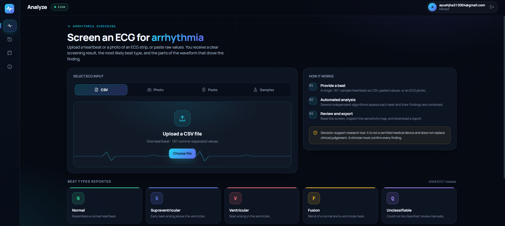

The main screen after login. The left rail switches between **Analyze**, **History**, **Guide** and **About**. The pill
beside the title shows **Live**, which means the backend has loaded all 8 models. There is no demo mode: if models are
missing the pill changes to "Models unavailable" and predictions are refused.

The input card offers four ways to provide an ECG:

| Tab | What it expects | What happens next |
|---|---|---|
| **CSV** | One heartbeat as 187 comma-separated values | The first row is read; a trailing label column is dropped |
| **Photo** | JPG or PNG of an ECG strip | The trace is recovered, cut into single beats and each beat is analysed |
| **Paste** | 187 values separated by commas, tabs or spaces | Same as CSV, with a live value counter |
| **Samples** | Synthetic beats generated in the browser | Demonstrates the interface only; not clinical data |

Below the input card, "Beat types reported" lists the five AAMI classes the models know: **N** normal, **S**
supraventricular ectopic, **V** ventricular ectopic, **F** fusion, **Q** unclassifiable.

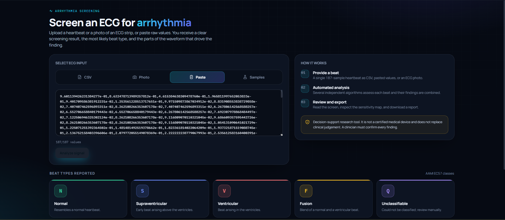

On the **Paste** tab the counter shows `187/187 values`. Pressing Analyze with any other count shows an error, because every
model expects exactly 187 samples. Scientific notation (for example `9.60E-01`), as found in the
MIT-BIH CSV files, is accepted.

## 3. Result for a single pasted beat

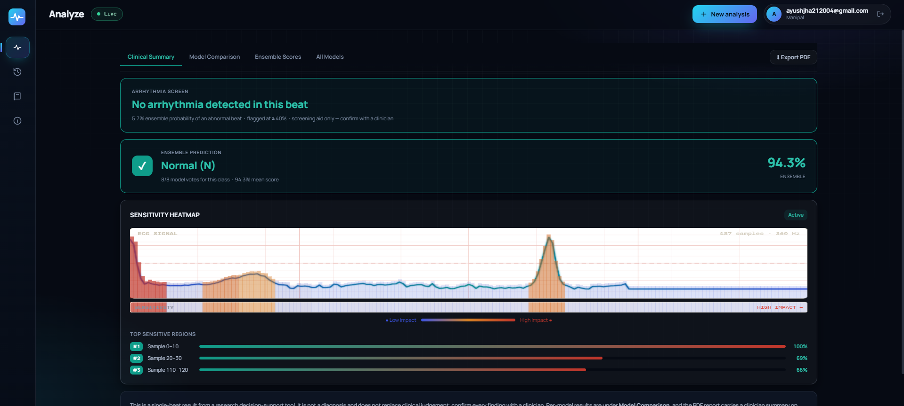

This is the **Clinical Summary** tab, which is the default and is written for the reviewing clinician.

1. **Arrhythmia screen.** The banner shows *No arrhythmia detected in this beat*, with an ensemble probability of an
   abnormal beat of **5.7%**. The logic: the 8 models' class probabilities are averaged, and
   `P(abnormal) = 1 - P(Normal)`. A beat is flagged when this reaches **40%**.
2. **Ensemble prediction.** The most likely beat type is **Normal (N)** with a mean score of 94.3%, and all 8 of 8 models
   voted Normal. The predicted class is the one with the highest *averaged probability*; the vote count is shown only as
   a measure of agreement.
3. **Sensitivity heatmap.** The beat is drawn with a colour ribbon: blue means low impact, amber moderate, red high.
   The "Top sensitive regions" list ranks the three 10-sample windows that most changed the prediction when hidden
   (here samples 0 to 10, 20 to 30 and 110 to 120).

How the heatmap is computed: a 10-sample window is slid across the 187-sample beat and set to zero. The whole ensemble is
re-run on each masked copy. The drop in the ensemble's probability for the predicted class is the window's sensitivity,
and the values are scaled so the largest drop is 1.0 (100%). The first window is often strongest here because MIT-BIH
beats start at the R peak, so zeroing the start removes the peak itself. Full details are in
[HOW_IT_WORKS.md, section 6](../HOW_IT_WORKS.md#6-the-sensitivity-heatmap-perturbation--occlusion-map).

## 4. Result for a photographed strip

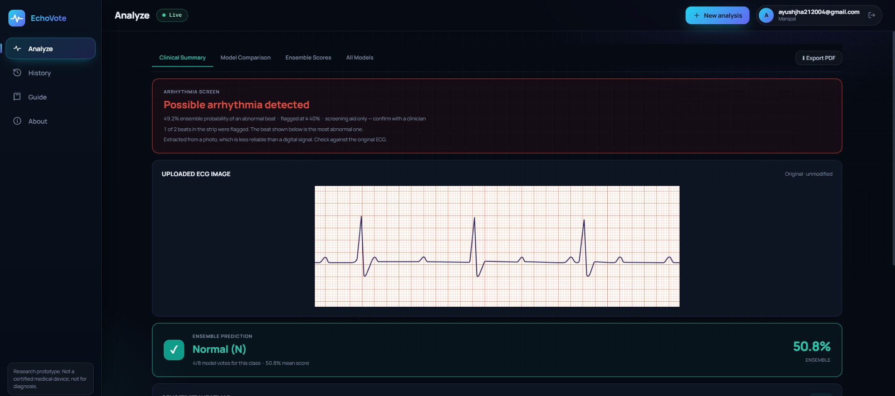

Here a photo of a 3-beat strip on orange ECG paper was uploaded.

* The banner reads *Possible arrhythmia detected* at **49.2%**, with the lines *1 of 2 beats in the strip were flagged*
  and *Extracted from a photo, which is less reliable than a digital signal*.
* Why 2 beats from 3 on the strip? The training data's beats run from one R peak to the next, so the app cuts the
  strip between consecutive R peaks. A strip with 3 R peaks therefore gives 2 complete beats.
* The strip-level rule: the strip is flagged when at least 20% of its beats are flagged, or any single beat scores 0.7 or
  more. The probability shown and the beat explained below belong to the most abnormal beat when the strip is flagged.
* The ensemble prediction is Normal at 50.8% with only **4 of 8** model votes. This is a borderline result, and the
  agreement tier on the Model Comparison tab shows it as LOW.
* The uploaded image is shown unmodified, so the clinician can check it against what the app read.

How the photo is read (summary; full steps in [HOW_IT_WORKS.md, section 3.2](../HOW_IT_WORKS.md#32-ecg-photos-and-scans-apipredictimage)):
1. Validate that the image is not blank and has enough contrast.
2. Find the trace pixels with a two-level Otsu threshold, so a dark trace is kept and a lighter coloured grid is dropped;
   remove long vertical rules and small fragments.
3. For each image column take the trace position, using the tip of vertical strokes so R peaks and S waves keep their
   height. Smooth, flip so peaks point up and normalise to 0 to 1.
4. Detect R peaks, cut between peaks, resample each beat to the training format (about 106 samples, zero-padded to 187)
   and analyse every beat.

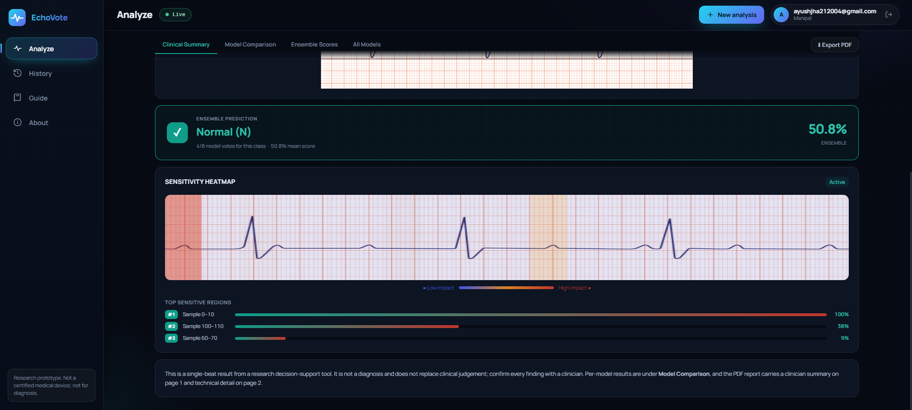

Scrolling down shows the heatmap for the photo. **Read this view with care:** the sensitivity values belong to the
single 187-sample beat the app analysed (the representative beat), but for photos the colours are drawn across the full
width of the uploaded image. So the position of a coloured band on the picture does not mark where on the strip the
influential segment is. See the limitations in section 11.

## 5. Model Comparison tab

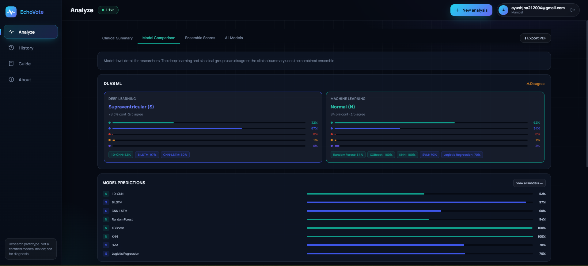

A tab for researchers. The 8 models are split into two groups:
* **Deep learning (3):** 1D-CNN, BiLSTM and CNN-LSTM. Here they predict **Supraventricular (S)**, with 78.3% mean
  confidence and 2 of 3 agreeing.
* **Machine learning (5):** Random Forest, XGBoost, KNN, SVM and Logistic Regression. They predict **Normal (N)**
  with 84.6% confidence and 3 of 5 agreeing.

The orange **Disagree** tag appears when the two groups pick different classes. The per-class bars show each group's
average probabilities, and the chips list each model's confidence in its own prediction. The "Model predictions" list
underneath gives every model's predicted letter and confidence.

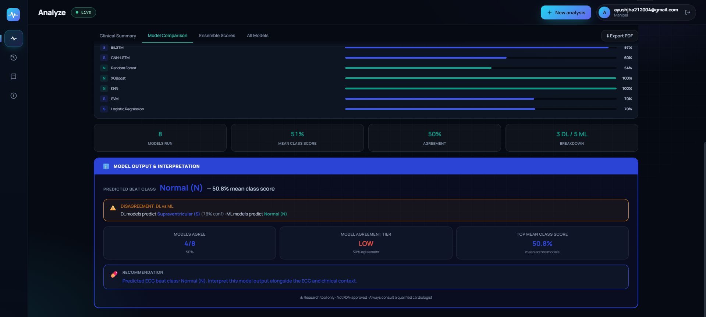

Further down: the four summary tiles (models run, mean class score, agreement, DL/ML split) and the **Model output &
interpretation** card. It spells out the disagreement ("DL models predict Supraventricular (S), ML models predict Normal
(N)") and shows the agreement tier. Agreement is the share of models that individually chose the predicted class:
**High** at 87.5% or more, **Moderate** at 62.5% or more, **Low** below that. Here 4 of 8 gives 50%, which is Low. A low
tier is a signal to review the beat manually.

## 6. Ensemble Scores tab

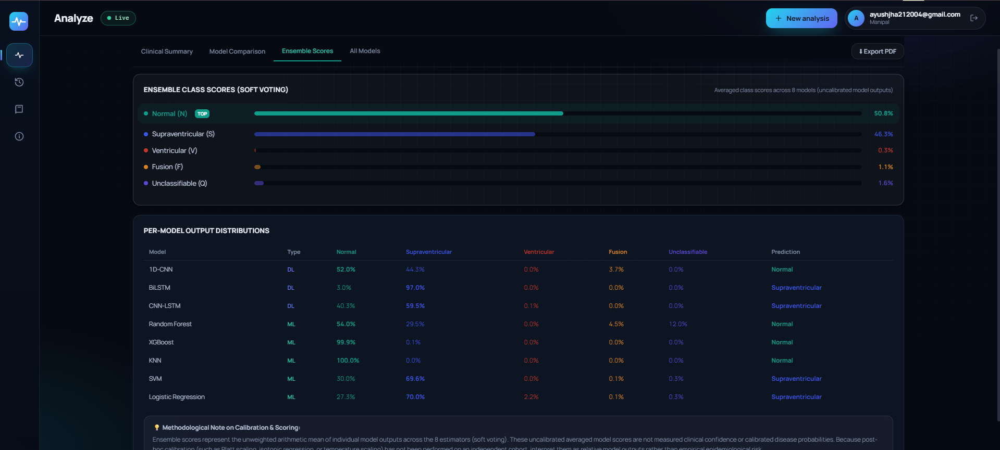

The averaged probability of each class across the 8 models (soft voting): Normal 50.8%, Supraventricular 46.3%,
Ventricular 0.3%, Fusion 1.1%, Unclassifiable 1.6%. The class with the highest mean (marked **TOP**) is the predicted
class. Exact ties follow the order N, S, V, F, Q.

The table below lists each model's full probability distribution. It shows why the result is close: the three
deep-learning models and the SVM and Logistic Regression lean Supraventricular, while Random Forest, XGBoost and KNN lean
Normal. The methodological note at the bottom is a reminder that these scores are **uncalibrated model outputs**, not
clinical probabilities.

## 7. All Models tab

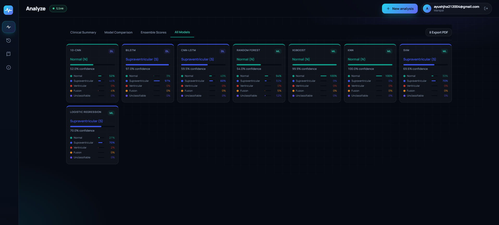

One card per model, showing its predicted class, confidence and its probabilities for all five classes. The card colour
shows the predicted class, and the **DL** or **ML** badge shows the model family. Use this tab to spot an outlier model
(for example, XGBoost and KNN are almost certain of Normal while BiLSTM is 97% sure of Supraventricular).

## 8. A strip with an irregular rhythm

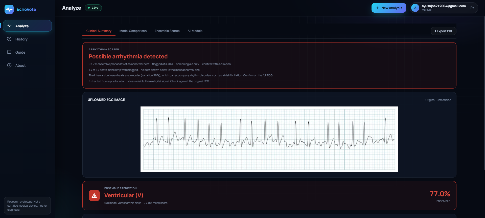

A longer strip with irregular spacing between beats. The banner shows:
* *Possible arrhythmia detected* at **97.7%**.
* *14 of 14 beats in the strip were flagged.*
* *The intervals between beats are irregular (variation 26%), which can accompany rhythm disorders such as atrial
  fibrillation. Confirm on the full ECG.*

The irregularity note comes from the R-R intervals: the app measures the spacing between consecutive R peaks and
computes the coefficient of variation (standard deviation divided by mean). Above 15%, with at least five peaks, it adds
the note. It is a simple, scale-free check, and it is not validated; a missed or extra peak can also make a strip look
irregular.

The predicted beat type is **Ventricular (V)** at 77.0% with 6 of 8 models. Note that the models only know five *beat
shapes*. They cannot recognise a rhythm disorder such as atrial fibrillation or flutter, so on a strip like this they
assign the nearest beat shape they know. "Arrhythmia flagged" may well be right, but the "Ventricular" label should not be
taken as the diagnosis.

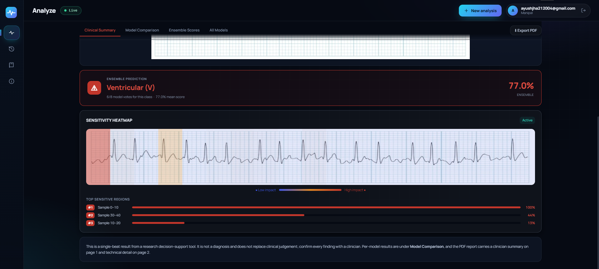

The heatmap for this strip (top regions: samples 0 to 10, 30 to 40 and 10 to 20). As with the first strip, the colours are
drawn over the full image width and describe the one analysed beat, not positions on the strip.

## 9. History

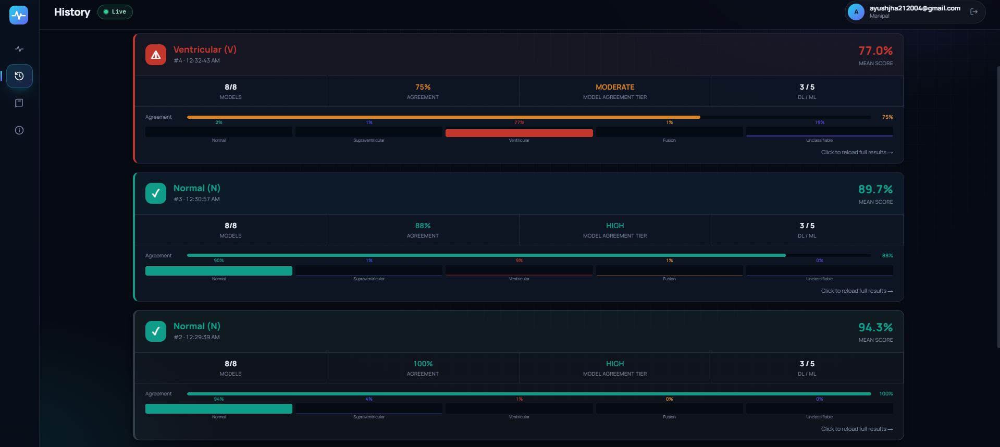

Every analysis in the current session is listed with the newest first (up to 10). Each card shows the predicted class
and mean score, the number of models that ran, the agreement percentage and tier, the DL/ML split, and the ensemble
probability of each class. Clicking a card reloads its full results. History is held in the browser and is cleared when
the page is refreshed or the user logs out.

Examples visible here: a Ventricular result at 77.0% with Moderate agreement (75%), a Normal result at 89.7% with High
agreement (88%), and a Normal result at 94.3% with 100% agreement.

## 10. Guide and About

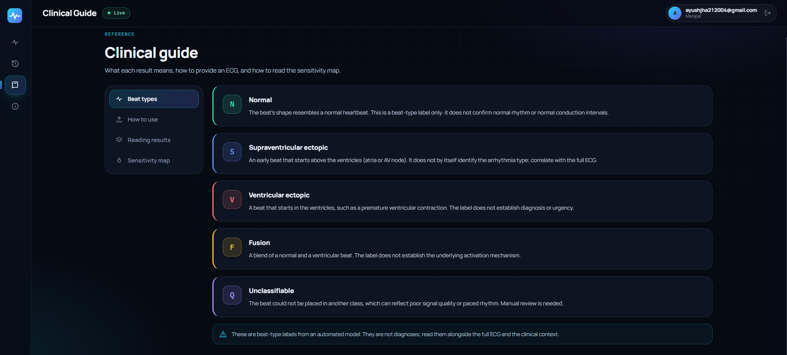

The **Clinical guide** has four sections reached from the side menu: **Beat types** (shown), **How to use**, **Reading
results** and **Sensitivity map**. Each beat type is explained in plain language, with the reminder that these are
beat-type labels and not diagnoses.

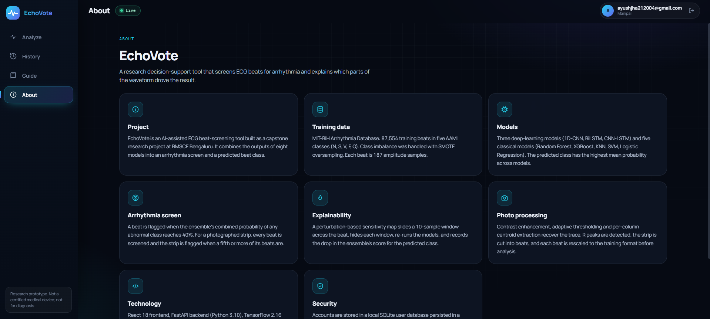

**About** summarises the project: the MIT-BIH training data (87,554 training beats in five classes), the eight models,
the arrhythmia-screen rule, the explainability method, the photo-processing steps, the technology stack and the account
security approach, followed by the research-use-only disclaimer.

## 11. Reading the results correctly: known limitations

* **Beat shapes, not rhythms.** The models classify the shape of individual beats. They cannot identify rhythm disorders
  such as atrial fibrillation or flutter. A regular, fast strip with a wavy baseline can still come out as "Normal".
* **Photos are a prototype feature.** The models were trained on digital MIT-BIH beats, not beats cut from photographs.
  The beat-finding was checked, but classification accuracy on real photos has **not been validated**. Expect false
  alarms and misses, and always check against the original ECG.
* **Heatmap on photos.** For photo uploads the heatmap colours are drawn across the whole image although they describe one
  extracted beat, so they do not indicate where on the strip a segment lies. For a pasted or CSV beat the heatmap lines
  up with the beat as expected.
* **Low agreement means low trust.** When the agreement tier is Low, or the deep-learning and classical groups disagree,
  treat the beat class as inconclusive and review manually.
* **Accuracy figures.** The headline test accuracy is beat-level on MIT-BIH, where test and training beats come from the
  same patients. A patient-wise evaluation has not been done, so accuracy on new patients will be lower. The 40% screening
  threshold was chosen before the deep-learning input fix and has not been re-tuned.
* **Speed.** One beat takes a few seconds. A strip with about 15 beats takes 1 to 2 minutes because every beat is run
  through all 8 models.
* **Synthetic samples** on the Samples tab only demonstrate the interface; the models often disagree on them.
* **Not a medical device.** Not certified by the FDA, CE or CDSCO. A qualified clinician must confirm every finding.

The PDF report (Export PDF button) is not shown in these screenshots. Its page 1 is a clinician summary and page 2 is a
technical appendix; both are described in [HOW_IT_WORKS.md, section 7](../HOW_IT_WORKS.md#7-frontend-flow).
